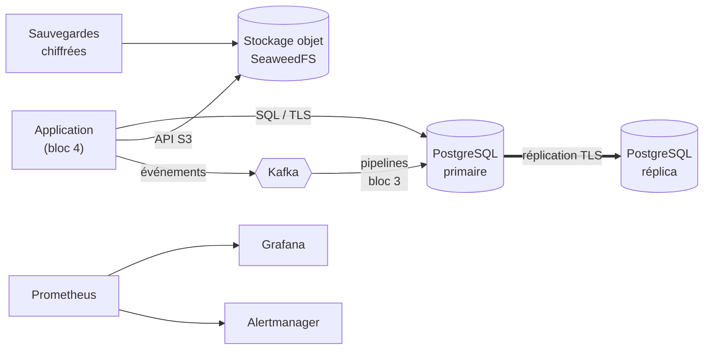

# Artelio — Plateforme data (Infrastructure as Code)

Infrastructure de données de **Artelio**, marketplace (fictive) qui met en relation particuliers et artisans
du bâtiment en Île-de-France. Elle stocke les données transactionnelles, les photos et les flux temps réel,
alimente un entrepôt analytique pseudonymisé, et intègre la conformité RGPD et la supervision.

> Certification « Architecte en Intelligence Artificielle » — **Bloc 2 : concevoir et déployer une architecture
> de données**. Toutes les données sont synthétiques ; aucune personne réelle.

| Document | Contenu |
|---|---|
| [Cahier des charges](docs/CAHIER_DES_CHARGES.md) | Besoins, volumétrie (3 V), exigences de disponibilité, sécurité et conformité |
| [Architecture](docs/ARCHITECTURE.md) | Schéma global, justification des choix, sécurité, continuité de service, évolutivité |
| [Modèle de données](docs/MODELE_DE_DONNEES.md) | Modèle relationnel (ERD), entrepôt en étoile, règles d'intégrité |

## Architecture en bref



| Composant | Rôle | Image |
|---|---|---|
| PostgreSQL primaire + réplica | Données transactionnelles (`app`), entrepôt en étoile (`dwh`), RGPD (`rgpd`), audit (`audit`) | `postgres:16.10` |
| SeaweedFS | Stockage objet S3 chiffré : `photos`, `factures`, `backups` | `chrislusf/seaweedfs:3.97` |
| Apache Kafka (KRaft) | Bus d'événements temps réel, 5 topics | `apache/kafka:3.9.1` |
| Agent de sauvegarde | Dump horaire chiffré AES-256 vers S3, rétention 30 jours | construit (`docker/backup`) |
| Prometheus, Alertmanager, Pushgateway, Grafana | Métriques, 8 règles d'alerte, 2 tableaux de bord | `prom/*`, `grafana/grafana:12.1.1` |
| Exporteurs | Métriques PostgreSQL (×2) et Kafka | `postgres-exporter`, `kafka-exporter` |

## Démarrage rapide

**Prérequis :** Docker (Desktop ou Engine, ~3 Go de RAM libres) et Terraform ≥ 1.6.

```bash
git clone <url-du-depot> && cd artelio-data-platform
./scripts/deploy.sh --seed
```

Cette commande crée les réseaux, volumes, secrets, certificats TLS et les 12 conteneurs, initialise les
buckets et les topics, charge un jeu de données synthétiques (3 000 clients, 350 artisans, 8 000 demandes),
puis affiche l'état de la plateforme :

```
Contrôles :
  [OK]     PostgreSQL primaire accepte les écritures
  [OK]     Réplication en flux active (TLS)
  [OK]     Stockage objet S3 opérationnel
  [OK]     Kafka répond
  [OK]     Prometheus : toutes les cibles sont joignables
  [OK]     Sauvegarde réussie depuis moins de 2 h
```

| Interface | Adresse |
|---|---|
| Grafana (utilisateur `admin`, mot de passe : `./scripts/grafana_password.sh`) | http://localhost:13000 |
| Prometheus | http://localhost:19090 |
| Alertmanager | http://localhost:19093 |
| PostgreSQL (TLS obligatoire) | `localhost:15432` (primaire), `localhost:15433` (réplica) |
| API S3 | http://localhost:18333 |
| Kafka | `localhost:19094` |

Tous les ports écoutent uniquement sur `127.0.0.1`. Ils ont été choisis pour ne pas entrer en conflit avec
d'autres projets ; ils se modifient dans `terraform/variables.tf` (variable `ports`).

## Démonstrations

| Commande | Ce qu'elle prouve |
|---|---|
| `./scripts/status.sh` | Santé de chaque composant |
| `./scripts/failover_demo.sh` | **Continuité de service** : panne du primaire, promotion du réplica en ~1 s, aucune perte. Retour à la normale : `--retablir` |
| `./scripts/restore_test.sh` | **Sauvegardes utilisables** : la dernière sauvegarde est déchiffrée, restaurée dans une base jetable et comparée à la production |
| `./scripts/run_tool.sh rgpd_demo.py` | **RGPD** : moindre privilège, export d'un client (accès et portabilité), effacement avec conservation légale des factures, purge des données expirées, registre et journal d'audit |

## Structure du dépôt

```
artelio-data-platform/
├── terraform/                 Infrastructure as Code (fournisseur Docker)
│   ├── versions.tf            Fournisseurs épinglés (docker, random, tls)
│   ├── variables.tf           Ports, images épinglées, topics, sauvegardes
│   ├── main.tf                Réseaux backend (interne) et edge
│   ├── secrets.tf             Mots de passe et PKI TLS générés
│   ├── postgres.tf            Primaire, réplica, exporteurs
│   ├── object_storage.tf      Stockage objet S3 et identités d'accès
│   ├── kafka.tf               Broker KRaft et exporteur
│   ├── backup.tf              Agent de sauvegarde
│   ├── monitoring.tf          Prometheus, Alertmanager, Pushgateway, Grafana
│   ├── tools.tf               Image Python et job d'initialisation
│   └── outputs.tf             URLs, secrets (sensibles)
├── docker/
│   ├── postgres/initdb/       Rôles, schéma métier, audit, RGPD, entrepôt, droits
│   ├── postgres/scripts/      Points d'entrée primaire / réplica, pg_hba.conf
│   ├── backup/                Image et scripts de sauvegarde
│   ├── monitoring/            Prometheus, règles d'alerte, Alertmanager, Grafana
│   └── tools/                 Image Python des scripts
├── scripts/                   Déploiement, démonstrations, données synthétiques
└── docs/                      Cahier des charges, architecture, modèle de données
```

## Sécurité

- **Aucun secret dans le dépôt.** Terraform les génère ; `terraform.tfstate` est exclu de Git.
- **TLS obligatoire** sur PostgreSQL : toute connexion réseau non chiffrée est refusée.
- **Chiffrement au repos** des volumes S3, des sauvegardes et des données de santé.
- **Moindre privilège** : 7 rôles PostgreSQL et 3 identités S3, chacun limité à son usage.
- **Réseau interne** sans accès Internet pour les données ; seules les interfaces humaines sont exposées, en local.
- **Journal d'audit** en ajout seul sur les 9 tables contenant des données personnelles.

## Exploitation

```bash
./scripts/deploy.sh                                  # applique une modification de configuration
terraform -chdir=terraform plan                      # prévisualise les changements
docker logs -f artelio-backup                        # journaux d'un composant
./scripts/run_tool.sh seed_data.py --demandes 20000  # base vide uniquement : plus de données
./scripts/destroy.sh                                 # supprime tout, données comprises (confirmation)
```

### Dépannage

| Symptôme | Cause probable | Solution |
|---|---|---|
| `port is already allocated` | Un autre service utilise le port | Changer la variable `ports` dans `terraform/variables.tf` |
| Le réplica reste « starting » | Le primaire n'est pas prêt ou le créneau de réplication est occupé | `docker logs artelio-pg-replica`, puis `./scripts/failover_demo.sh --retablir` |
| Grafana « Loading plugin panel » | Premier chargement après déploiement | Patienter quelques secondes et recharger |
| `Cannot connect to the Docker daemon` | Docker n'est pas lancé | Démarrer Docker Desktop |
