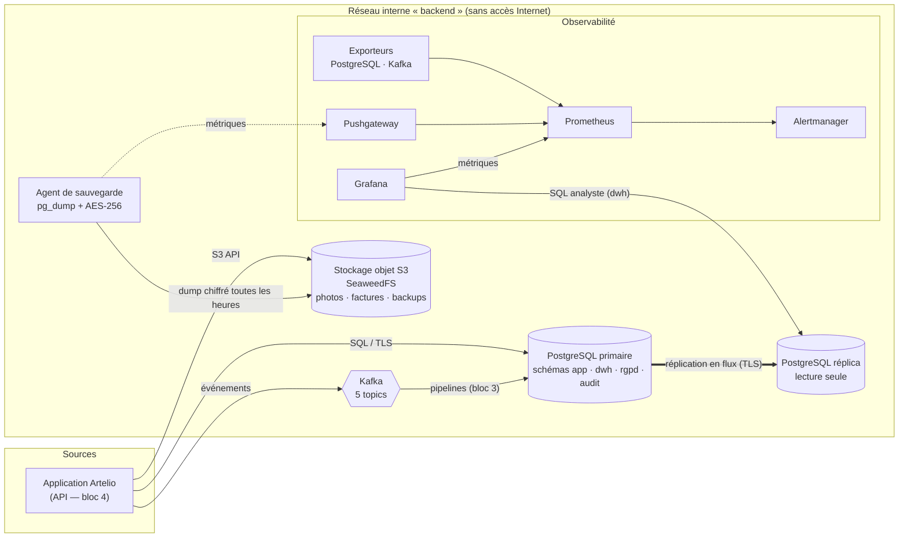

# Architecture de la plateforme data Artelio

> Ce document justifie chaque choix. Les exigences citées (F1, NF2, S4…) renvoient au
> [cahier des charges](CAHIER_DES_CHARGES.md).

## 1. Vue d'ensemble

**Principe :** chaque type de donnée va dans l'outil fait pour lui (exigence de variété), tous les flux
passent par un réseau isolé, et tout est décrit en code (Terraform) pour être recréé à l'identique.

## 2. Choix des composants

| Besoin | Choix | Alternatives écartées | Pourquoi ce choix |
|---|---|---|---|
| Données transactionnelles et semi-structurées (F1, F2) | **PostgreSQL 16** | MySQL, MongoDB | Transactions ACID indispensables pour les devis et factures. Le type **JSONB** indexé (GIN) couvre les données semi-structurées (messages, lignes de devis) sans ajouter une seconde base à exploiter. Fonctions avancées utiles à la conformité : chiffrement (pgcrypto), triggers d'audit, rôles fins. |
| Fichiers volumineux (F3) | **Stockage objet S3 — SeaweedFS** | Fichiers en base (BLOB), MinIO, AWS S3 | 120 Go/mois de photos n'ont rien à faire dans une base relationnelle : coût, sauvegardes lentes. L'API S3 est un standard, ce qui permet de basculer vers n'importe quel fournisseur S3. **MinIO a cessé de publier ses images communautaires en 2025** ; SeaweedFS est open source (Apache 2.0), maintenu, et chiffre les données au repos. |
| Flux temps réel (F4, NF4) | **Apache Kafka 3.9 (KRaft)** | RabbitMQ, Redis Streams | Kafka absorbe les pics (200 événements/s, ×3 demain) en découplant l'application des pipelines. Il **conserve** les messages 7 jours : un pipeline en panne reprend là où il s'était arrêté, sans perte. Le mode KRaft supprime ZooKeeper, donc un composant de moins. |
| Analytique (F5, F6) | **Entrepôt en étoile dans PostgreSQL** (schéma `dwh`) | ClickHouse, BigQuery, Snowflake | À ~10 000 demandes/mois, un entrepôt dédié serait surdimensionné. Le modèle en étoile est **portable** : si le volume l'exige, les mêmes tables migrent vers ClickHouse sans changer les tableaux de bord. Les analyses tournent sur le **réplica**, donc sans ralentir la production. |
| Supervision (NF6) | **Prometheus + Alertmanager + Grafana** | Datadog, ELK | Standard open source, aucun coût de licence, des exporteurs prêts à l'emploi pour chaque composant. |
| Infrastructure as Code (NF7) | **Terraform** + fournisseur Docker | Docker Compose, Ansible, Kubernetes | Terraform décrit l'état voulu (réseaux, volumes, conteneurs, **secrets, certificats TLS**) et le même outil piloterait demain un cloud. Kubernetes serait surdimensionné pour une équipe de 4 personnes. |

## 3. Sécurité

### 3.1 Réseau (S10)

| Réseau | Type | Qui y est connecté |
|---|---|---|
| `artelio-backend` | **interne** : aucune route vers Internet | Tous les services |
| `artelio-edge` | pont standard | Uniquement les services qu'un humain consulte (Grafana, Prometheus, Alertmanager, PostgreSQL, S3, Kafka) |

Les ports publiés écoutent **uniquement sur 127.0.0.1** : rien n'est accessible depuis une autre machine.

### 3.2 Chiffrement (S1)

| Où | Comment |
|---|---|
| En transit — PostgreSQL | TLS 1.2 minimum **obligatoire** : `pg_hba.conf` refuse toute connexion réseau non chiffrée. Certificats émis par une autorité interne générée par Terraform. La réplication vérifie le certificat du primaire (`sslmode=verify-full`). |
| Au repos — stockage objet | Chiffrement des volumes SeaweedFS (`-filer.encryptVolumeData`, AES-256-GCM, une clé par fragment). |
| Au repos — sauvegardes | AES-256 (openssl, dérivation de clé PBKDF2 à 200 000 itérations) avant l'envoi dans S3. |
| Au repos — donnée de santé | Colonne chiffrée par pgcrypto (`besoins_accessibilite.description_chiffree`). |
| Mots de passe | Hachés en SCRAM-SHA-256. |

### 3.3 Contrôle d'accès (S2)

| Compte PostgreSQL | Peut | Ne peut pas |
|---|---|---|
| `app_api` | Lire et écrire le métier | Modifier les consentements ou les factures (preuves), lire l'audit |
| `pipeline_etl` | Lire le métier, écrire l'entrepôt | Lire les **données de santé** |
| `analyst` | Lire l'entrepôt pseudonymisé | Voir un nom, un email ou une adresse |
| `dpo_officer` | Exécuter les fonctions RGPD, lire l'audit | Lire directement les tables (tout passe par des fonctions tracées) |
| `monitoring` | Lire les statistiques | Lire une seule donnée métier |
| `backup_agent` | Tout lire | Écrire quoi que ce soit |

Côté S3, l'identité `app` n'accède qu'aux buckets `photos` et `factures`, l'identité `backup` qu'à `backups`.

### 3.4 Secrets (S11)

Tous les mots de passe et clés sont générés par Terraform (`random_password`) et injectés en variables
d'environnement. Aucun n'est écrit dans le dépôt ; l'état Terraform qui les contient est exclu de Git.
**En production :** état Terraform dans un backend distant chiffré, secrets dans un coffre (Vault, gestionnaire
de secrets du cloud), rotation trimestrielle.

## 4. Fiabilité et continuité de service

| Mécanisme | Ce qu'il protège | Preuve |
|---|---|---|
| **Réplica en flux** (`pg-replica`) | Panne du serveur primaire : bascule en ~1 s, sans perte des données répliquées | `scripts/failover_demo.sh` |
| **Créneau de réplication** (`replica_1`) | Le primaire garde les journaux tant que le réplica ne les a pas reçus | `06_grants.sql` |
| **Sauvegardes horaires chiffrées** | Erreur humaine, corruption, rançongiciel : retour à H-1 (RPO 1 h) | `docker/backup/backup.sh` |
| **Test de restauration** | Une sauvegarde jamais testée n'est pas une sauvegarde | `scripts/restore_test.sh` |
| **Sommes de contrôle des pages** (`--data-checksums`) | Détection de corruption silencieuse du disque | `terraform/postgres.tf` |
| **Rétention Kafka 7 jours** | Panne d'un pipeline : rejeu des événements | `scripts/init_platform.py` |
| **Redémarrage automatique** (`restart = unless-stopped`) | Plantage d'un processus | `terraform/*.tf` |
| **Infrastructure as Code** | Perte totale de l'hôte : recréation en une commande (RTO 8 h) | `scripts/deploy.sh` |

## 5. Évolutivité (NF5)

L'environnement livré tourne sur une seule machine. Le passage en production ne change pas l'architecture,
seulement le nombre d'instances :

| Composant | Aujourd'hui | Production (×3) |
|---|---|---|
| PostgreSQL | 1 primaire + 1 réplica | 1 primaire + 2 réplicas, bascule automatique (Patroni), pool de connexions (PgBouncer) |
| Kafka | 1 broker | 3 brokers, facteur de réplication 3, `min.insync.replicas=2`, chiffrement SASL_SSL |
| Stockage objet | 1 serveur | Plusieurs serveurs de volumes, réplication des données (`-defaultReplication=001`) |
| Entrepôt | Schéma `dwh` dans PostgreSQL | Migration vers ClickHouse si les requêtes analytiques dépassent quelques secondes |

Les topics Kafka sont déjà **partitionnés** (6 partitions pour les flux principaux) : on peut ajouter des
consommateurs en parallèle sans rien modifier.

## 6. Conformité

| Exigence | Mise en œuvre technique |
|---|---|
| **RGPD — droits des personnes (S5)** | `rgpd.exporter_client()` produit un export JSON complet (accès et portabilité) ; `rgpd.effacer_client()` efface et renvoie la liste des photos à supprimer dans S3. Chaque demande est inscrite dans `rgpd.registre_demandes`. |
| **RGPD — durées de conservation (S6)** | `rgpd.purger_donnees_expirees()` : positions GPS > 24 h, données de santé expirées, photos > 12 mois après l'intervention, comptes inactifs > 3 ans. Lancée chaque nuit par l'orchestrateur (bloc 3). |
| **Obligation comptable (S7)** | Les factures copient l'identité de facturation et sont conservées ; le reste du compte client est anonymisé. |
| **Pseudonymisation (S4)** | L'entrepôt ne contient que des HMAC-SHA256 des identifiants, calculés avec une clé que seul le pipeline possède. |
| **Traçabilité (S3)** | Triggers d'audit sur les 9 tables contenant des données personnelles. Journal **en ajout seul** : toute modification est refusée, même par l'administrateur applicatif. |
| **Données de santé (S8)** | Table séparée, chiffrée, invisible pour le pipeline et l'analytique, supprimée 30 jours après l'intervention (plan de gouvernance §5.2). |
| **ISO 27001 / ANSSI** | Cloisonnement réseau, moindre privilège, chiffrement, journalisation, sauvegardes testées, supervision : les mesures techniques de l'annexe A couvertes par la plateforme. |
| **Secteur** | Pas de secteur réglementé spécifique (ni santé, ni finance). Le paiement est délégué à Stripe : **aucune donnée de carte** ne transite par la plateforme, donc pas de périmètre PCI-DSS. |

## 7. Limites connues (et assumées)

| Limite | Pourquoi | Ce qui est prévu |
|---|---|---|
| Kafka en clair (PLAINTEXT) sur le réseau interne | Réseau isolé sans accès extérieur ; simplicité du lab | SASL_SSL en production |
| Clés de chiffrement attachées aux rôles PostgreSQL | Pas de coffre de secrets dans l'environnement local | Coffre de secrets (Vault / KMS) |
| Bascule PostgreSQL manuelle | Démonstration du mécanisme | Patroni + etcd pour une bascule automatique |
| Volumes Docker locaux non chiffrés au niveau du disque | Dépend de l'hôte | Disques chiffrés chez l'hébergeur |
