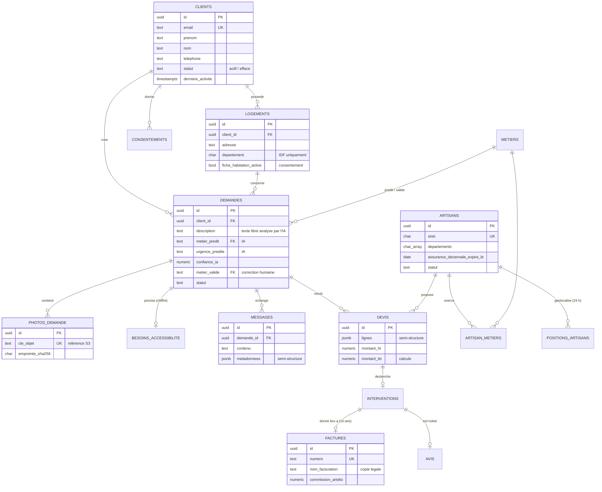
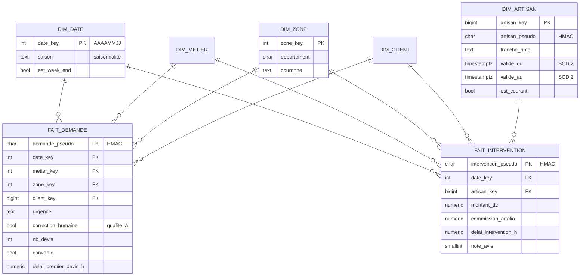

# Modèle de données

Deux modèles complémentaires dans la même base PostgreSQL :

- **`app`** — modèle **relationnel normalisé** (OLTP) : optimisé pour écrire vite et sans incohérence.
- **`dwh`** — modèle **en étoile** (OLAP) : optimisé pour analyser vite, sans données identifiantes.

## 1. Modèle transactionnel (schéma `app`)

### Règles d'intégrité portées par la base (et pas seulement par l'application)

| Règle | Mise en œuvre |
|---|---|
| Uniquement l'Île-de-France | `CHECK (departement IN ('75','77','78','91','92','93','94','95'))` |
| SIRET valide | `CHECK (siret ~ '^[0-9]{14}$')` + unicité |
| TVA légale du bâtiment | `CHECK (taux_tva IN (0.055, 0.100, 0.200))` |
| Montant TTC jamais faux | Colonne **calculée** : `montant_ht × (1 + taux_tva)` |
| Photo ≤ 15 Mo, format image | `CHECK` sur la taille et le type MIME |
| Une facture ne disparaît pas | `ON DELETE RESTRICT` + aucun droit `DELETE` pour l'application |
| Emails normalisés | `CHECK (email = lower(email))` |

## 2. Entrepôt en étoile (schéma `dwh`)

### Choix de modélisation

| Choix | Raison |
|---|---|
| **Deux tables de faits** au grain différent (demande, intervention) | Toutes les demandes ne deviennent pas des interventions : les mélanger fausserait les taux de conversion. |
| **Dimension date** pré-calculée (2024 → 2030) avec la **saison** | Les analyses de saisonnalité (chauffage en hiver) n'ont pas à recalculer les dates. |
| **Dimension artisan historisée (SCD type 2)** | Si un artisan change de zone ou de note, les interventions passées restent rattachées à ses caractéristiques de l'époque. |
| **Tranches** plutôt que valeurs exactes (note, ancienneté) | Minimisation : l'analyse n'a pas besoin de la valeur exacte, et une tranche identifie moins. |
| **Identifiants pseudonymisés** (HMAC-SHA256 avec clé secrète) | Un analyste ne peut pas remonter à la personne ; un simple hachage sans clé serait réversible par force brute sur les UUID connus. |
| `correction_humaine` dans les faits | Mesure en continu de la qualité du modèle IA (supervision humaine exigée par le plan de gouvernance). |

## 3. Où va chaque type de donnée

| Type | Exemple | Stockage | Accès |
|---|---|---|---|
| Structuré | Clients, devis, factures | PostgreSQL `app` (tables) | SQL, TLS |
| Semi-structuré | Métadonnées des messages, lignes de devis | PostgreSQL `app` (JSONB indexé GIN) | SQL + opérateurs JSON |
| Non structuré | Photos, factures PDF | Stockage objet S3 (la base garde la clé et l'empreinte SHA-256) | API S3 |
| Flux d'événements | Demande créée, message envoyé | Kafka (7 jours) | Producteurs / consommateurs |
| Analytique | Indicateurs | PostgreSQL `dwh` (étoile) | SQL, compte `analyst`, sur le réplica |
